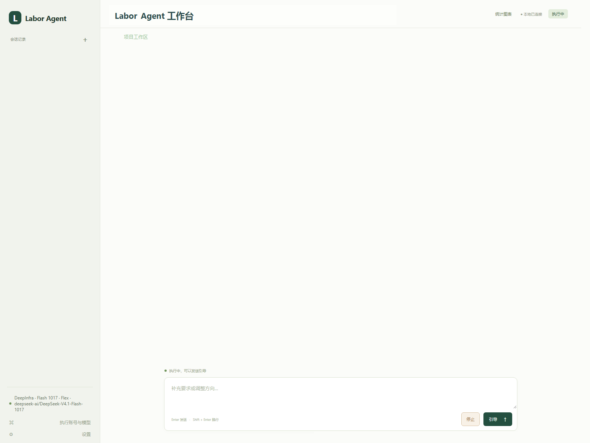
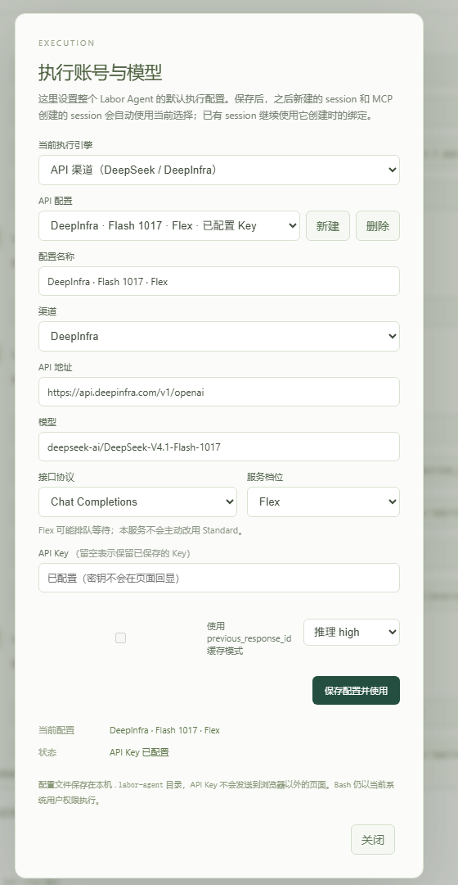
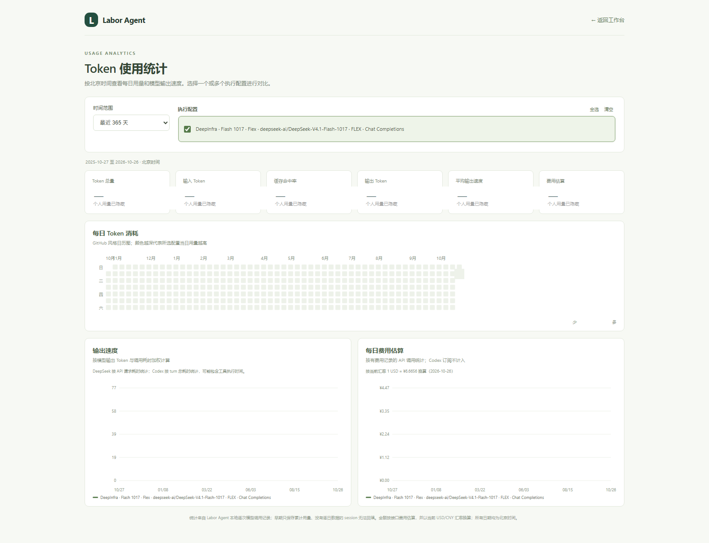

# Labor Agent

[简明中文指南](README_CN.md) · [English guide](README_EN.md)

Labor Agent 是运行在本机的编程执行 Agent。它通过网页或 MCP 接收任务，在指定项目目录里使用 `read / write / edit / bash` 工具工作。网页与 MCP 共用后台、持久会话和执行记录；可在左下角切换 DeepSeek API、Codex 订阅及已保存的执行配置。统计页汇总 Token、缓存命中率、输出速度和 API 费用估算，费用会因渠道数据与计价规则而有差异。

核心使用独立实现的轻量工具循环；交互方式受 DeepSeek Harness 启发，不依赖、复制或修改 Harness 的私有运行时。

## 界面预览

以下截图来自实际运行的本地界面；会话标识、项目路径和个人用量数字已遮盖。

<table>
  <tr>
    <td align="center"><a href="docs/screenshots/workbench.png"></a><br>工作台：会话、项目目录与实时执行状态</td>
    <td align="center"><a href="docs/screenshots/execution-settings.png"></a><br>执行账号与模型配置</td>
  </tr>
  <tr>
    <td colspan="2" align="center"><a href="docs/screenshots/token-statistics.png"></a><br>Token 消耗、缓存命中、输出速度和费用估算</td>
  </tr>
</table>

## 快速启动

需要 Node.js 22 或更新版本。Windows 需要 Git Bash（本机会自动检测 `C:/Program Files/Git/bin/bash.exe`）。

```powershell
cd D:\codes\labor_agent
npm install
Copy-Item .env.example .env   # 已有 .env 时跳过，避免覆盖
```

编辑项目根目录的 `.env`：

```dotenv
LABOR_API_KEY=你的DeepSeek密钥
LABOR_BASE_URL=https://api.deepseek.com
LABOR_MODEL=deepseek-flash
LABOR_CACHE_MODE=local
```

```powershell
npm run build
npm start
```

服务启动后会自动打开默认浏览器；如果没有自动打开，可访问 <http://127.0.0.1:3210>。也可以运行 `./start.ps1` 自动准备依赖并启动。界面显示会话列表、对话和输入框，可以手动选择已有会话、发送消息、在执行中引导或停止。左下角“执行账号与模型”用于统一选择 DeepSeek API 或 Codex 订阅；DeepSeek 的地址、模型和 API Key 可在页面保存为多个配置并切换，Codex 账号和模型也在这里管理。左侧“＋”只负责新建 session 和选择项目文件夹，之后自动继承全局执行配置。MCP 仍可通过 `session_create` 建立会话。

后台运行和管理：

```powershell
npm run start:bg
npm run status
npm run restart  # 修改 .env 后运行；先停止旧服务，再编译并启动
npm run stop
```

`npm start` 是前台运行，按 Ctrl+C 退出。MCP 自动启动的后台独立于 MCP 客户端生命周期；用 `npm run stop` 关闭。后台日志位于 `.labor-agent/server.log`。若修改了 `LABOR_DATA_DIR`，请先关闭旧服务。

## 配置项

| 环境变量 | 默认值 | 说明 |
| --- | --- | --- |
| `LABOR_API_KEY` | 空 | DeepSeek API Key；也接受 `DEEPSEEK_API_KEY` |
| `LABOR_BASE_URL` | `https://api.deepseek.com` | API 基址；也接受 `DEEPSEEK_BASE_URL`。会追加 `/responses`，也可直接填写完整 `/responses` 地址 |
| `LABOR_MODEL` | `deepseek-flash` | 模型名；可改为账号/网关支持的其他模型，例如 `deepseek-v4-pro` |
| `LABOR_API_FORMAT` | `responses` | API 协议：`responses` 或 `chat_completions`；页面配置可为每个渠道单独指定 |
| `LABOR_SERVICE_TIER` | `default` | Chat Completions 服务档位：`default / flex / priority` |
| `LABOR_CACHE_MODE` | `local` | `local` 或 `previous_response_id` |
| `LABOR_REASONING_EFFORT` | `high` | `none / low / high / max` |
| `LABOR_WORKSPACE` | `.` | 新会话默认工作目录 |
| `LABOR_DATA_DIR` | `.labor-agent` | 会话文件、当前选择、服务锁及日志 |
| `LABOR_PORT` | `3210` | 本地网页 / 内部 HTTP API 端口 |
| `LABOR_BASH_PATH` | 自动检测 | Bash 可执行文件路径 |
| `LABOR_MAX_OUTPUT_TOKENS` | `32768` | 每次模型响应的输出上限（包含推理） |
| `LABOR_CONTEXT_LIMIT_TOKENS` | `1048576` | 上下文预算上限；DeepSeek Flash 默认按 1M 实测上限，其他模型或网关应覆盖 |
| `LABOR_CONTEXT_WARN_RATIO` | `0.9` | 发起请求前的上下文预警阈值；达到后本轮请求会被拦截 |
| `LABOR_TOOL_CONTEXT_CHARS` | `4000` | 普通工具结果进入模型上下文的最大字符数；完整捕获结果仍保存在会话记录中 |
| `LABOR_REQUEST_TIMEOUT_MS` | `180000` | 单次 API 请求超时，毫秒 |
| `LABOR_CODEX_COMMAND` | `codex` | 可选的 Codex CLI 命令或路径 |
| `LABOR_CODEX_HOME` | `.labor-agent/codex-accounts/default` | Labor Agent 独立 Codex 登录目录 |
| `LABOR_CODEX_SQLITE_HOME` | `~/.codex` | 与 Codex 客户端共享线程索引的 SQLite 目录 |
| `LABOR_CODEX_DIRECT` | `true` | 是否清理代理环境后启动 Codex；本机有可用代理时可设为 `false` |

`.env` 从本项目根目录读取，与 MCP 客户端当前目录无关。相对路径也以本项目根目录解析；创建会话时提供的相对目录以默认工作目录解析。进程环境变量优先于 `.env`。页面保存的 DeepSeek 配置位于 `.labor-agent/provider-profiles.json`，新建 session 会绑定当前配置；已有 session 保留创建时的配置。Codex 的文件权限模式也在左下角设置中保存，默认是完整权限，可切换为项目写入或只读。修改 `.env`、端口或数据目录需要重启服务；页面保存的账号切换立即对之后新建的 session 生效。不会自动读取 Harness 的密钥。

## DeepInfra 渠道

在左下角“执行账号与模型”选择 API 渠道，新建配置并将渠道选为 DeepInfra。页面会预填地址 `https://api.deepinfra.com/v1/openai`、模型 `deepseek-ai/DeepSeek-V4.1-Flash-1017`、Chat Completions 协议和 Flex 档位。输入自己的 API Token 后保存并启用，新 session 会继承该配置；旧 session 继续使用原渠道。

Chat Completions 使用本地完整历史，不支持 `previous_response_id`。工具调用、流式回复、缓存命中 token 和推理内容续传均经过协议转换；DeepInfra 返回的 `estimated_cost` 累加用于费用显示，`service_tier` 记录实际服务档位。Flex 请求可排队较久，因此该档位将单次超时下限设为 15 分钟；本服务不会为重试主动改用 Standard。Flash 1017 已验证接口接受 32,768 tokens 的输出上限参数，本服务对它取 `LABOR_MAX_OUTPUT_TOKENS` 与 32,768 的较小值，其他 DeepInfra 模型保守限制为 16,384。推理、正文和工具参数共享此预算；大文件应分段生成。遇到 `length` 时显示用量与参数大小，本次响应中的工具调用均不执行，也不自动重试；已完成操作与历史保留，可发送新消息继续。价格与可用性以 [DeepInfra 模型页面](https://deepinfra.com/deepseek-ai/DeepSeek-V4.1-Flash-1017/api) 为准。

## 在 Codex 中使用 MCP

```powershell
npm run build
npm run setup:mcp
```

会生成或更新当前项目的 `.codex/config.toml`，使用本机 Node 的绝对路径运行 `dist/mcp.js`，并将 MCP 工具超时设为 1860 秒（等待上限 30 分钟，另留 1 分钟余量）。在 Codex 中重新打开此项目或重启会话以加载 MCP。项目配置需要项目已受信任；参见 [Codex 官方 MCP 文档](https://learn.chatgpt.com/docs/extend/mcp)。当前已运行的聊天不会因为文件写入就自动获得新工具。

其他 MCP 客户端可使用（将路径改成本机实际路径）：

```json
{
  "mcpServers": {
    "labor_agent": {
      "command": "C:/Program Files/nodejs/node.exe",
      "args": ["D:/codes/labor_agent/dist/mcp.js"]
    }
  }
}
```

| MCP 工具 | 用途 |
| --- | --- |
| `agent_start` | 启动/连接后台，返回运行状态、模型和配置状态；服务启动时自动打开界面 |
| `session_create` | 创建并选择会话，可传 `title`、`workspace`、`backend`、`profile_id`、`model` |
| `session_list` | 列出会话和当前选择 |
| `session_select` | 用 `session_id` 切换当前默认会话；普通协作显式传 `session_id` 即可 |
| `session_get` | 读取对话和工具记录；工具结果默认只给摘要，可按角色过滤、向前分页，或按消息 ID 读取完整内容 |
| `agent_send` | 传 `text` 对话；空闲时启动一轮，执行中自动作为引导。可传 `session_id`、`wait_ms`（0–1800000；省略时按历史动态等待，引导立即确认） |
| `agent_status` | 立即查询执行状态和最近记录；可选 `wait_ms` |
| `agent_wait` | 等待会话结束或超时；省略 `wait_ms` 时按历史动态等待，单次最长 30 分钟 |
| `agent_cancel` | 中止指定/当前会话的请求与 Bash 进程树 |

典型调用顺序：

```text
agent_start {}
session_create {"title":"项目巡检","workspace":"D:/codes/your-project"}
agent_send {"text":"读取项目说明并检查启动方式。"}
agent_wait {}
session_get {"limit":30}
```

`session_get` 默认返回最近 30 条消息；工具结果与工具参数仅提供短预览，并受总字符预算限制。需要核对某条结果时，把返回的消息 `id` 传入 `message_ids`，即可读取指定消息的完整文本；若返回 `textTruncated: true`，可增大 `max_chars`。`roles` 用于筛选 `user`、`assistant`、`tool`、`system`，`before_message_id` 用于向前分页。读取完整工具参数需显式设置 `include_tool_args: true`。session 元数据还会返回 `contextBudget`，包括估算 token、配置上限、预留输出和当前比例。

为减少主 AI 的轮询开销，省略 `agent_send` 和 `agent_wait` 的 `wait_ms` 可启用历史自适应等待：系统优先按同一后端、配置和模型最近最多 100 次完成任务的 P80 估算剩余时长；精确配置样本不足时改用同后端历史，样本仍不足 5 次时等待 30 分钟。单次等待最长 30 分钟；超过历史 P80 仍未结束时，后续继续等待 30 分钟。等待工具监听会话状态变化，结束、报错或取消时立即返回，不会固定等满时限。等待历史写入 `.labor-agent/metrics/agent-runs.jsonl`；也可显式传 `wait_ms`（0–1800000）覆盖默认值。不要用 `agent_send` 发送“继续/等待”来轮询，因为运行中的发送会成为任务引导。

工具未传 `session_id` 时使用当前选中的会话。长任务返回 `running` 后会继续执行，通过 `agent_wait` 等它结束；`agent_status` 用于立即查看状态。不要为了轮询重复 `agent_send`，运行中再次发送的文本会成为当前任务的引导。空闲时发送才启动新一轮。同一会话同时只运行一轮，不同会话可独立运行。读写同一个工作目录时，应避免给不同会话下发冲突的任务。

### 执行中的引导

任务运行时输入框保持可用，按钮显示“引导”。直接补充要求，例如“先不要改页面样式，完成当前步骤后只检查退出流程”。MCP 也通过同一个 `agent_send` 发送，不需要选择模式。

- 消息立即保存并标为“引导 · 待应用”，`pendingGuidance` 返回待应用条数。
- 当前 API 响应或工具执行结束后，后台跳过尚未开始的旧工具调用，在下一次模型调用前按顺序加入引导，让 Agent 重新安排。
- 纳入上下文后标为“引导 · 已纳入上下文”；这表示已加入请求历史，不代表要求已经实现或验收通过。
- 引导不会即时打断当前 Bash，也不会回滚已完成的修改。需要立即中断时使用“停止”/`agent_cancel`。
- 停止、报错或重启后未应用的引导仍保留，继续对话时处理。当前没有固定40次模型调用上限；任务会持续到完成、取消或发生错误。

## 用对话派发与验收（配套 skill）

项目中提供 [labor-agent skill](skills/labor-agent/SKILL.md)，用于让 Codex 通过 MCP 与 Labor Agent 协作。安装到本机 Codex skills 目录：

```powershell
npm run setup:skill
```

默认安装到 `~/.codex/skills/labor-agent`，设置了 `CODEX_HOME` 时使用它的 `skills` 子目录。源文件保存在本项目 `skills/labor-agent`。已有不同版本时不会直接覆盖，可在确认更新后运行 `npm run setup:skill -- --update`。重新打开会话刷新技能列表后，可直接说：

```text
使用 $labor-agent，让 Labor Agent 完成这个项目的登录退出修复。
验收标准是：退出后返回登录页、刷新后仍未登录、受保护页面不可直接访问。
你检查它的产物和证据，未通过就继续在同一会话反馈修正。
```

协作过程：Codex 用 `agent_send.text` 说清目标、范围、验收标准；Labor Agent 自主选择工具并执行，回复逐条验证结果和证据；Codex 读取记录并核验真实文件与必要行为，再用普通对话追问或反馈修改。没有额外的工具选择、任务类型表单或强制 JSON 任务协议。

验收标准保存在对话上下文中，后续可明确变更；未执行的检查需标记为未验证。`idle` 只表示本轮结束，不能直接当成验收通过。默认一个 session 对应一个任务或交付阶段；补充、验收修正和恢复沿用原会话，阶段验收完成后，即使同项目也为下一任务创建新 session，只交接关键要求、验收标准和成果路径，避免复制全部历史。该规则由 MCP/skill 引导协调者执行，不会自动判断阶段或切换正在运行的会话。协作时应保存并显式传 `session_id`，避免网页切换会话后任务被发到其他会话。

## 上下文和缓存

- **模型耗时记录**保存在数据目录的 `metrics/<session-id>.jsonl`，每行对应一次调用。DeepSeek/DeepInfra 记录单次 API 请求从发出到完整收流的耗时、输入/输出/缓存/推理 token、服务档位和首段可见文字时间；这个耗时包含服务商排队，不包含本地工具执行。Codex app-server 不公开内部单次模型请求边界，因此按整轮 turn 记录耗时和可获得的 token 增量，可能包含 Codex 工具执行时间，统计时应与 API 请求分开。Agent 整轮耗时另记在 `metrics/agent-runs.jsonl`，供 MCP 等待按同一后端和配置的历史 P80 动态调整。记录不包含提示词、工具参数或 API Key。
- **DeepSeek 默认 `local`**：持久保存并续传 Responses 模型历史（包括 reasoning、工具调用和工具结果预览）；工具完整捕获结果另外保存在会话消息中供网页/MCP 查阅。重启后台后可以继续旧会话。
- **工具结果按需读取**：普通工具结果默认最多向模型提供 4,000 字符预览；Bash 保留退出码、错误和输出首尾。Labor 内部可用 `tool_result_get` 按 `result_id`、字符 `offset` 和 `limit` 分页读取会话记录，不必重新执行命令。默认每页 4,000、最大 8,000 字符；显式详情页不再二次裁切。新结果只追加到历史，已有历史与调用配对不改写，保护前缀缓存和 `previous_response_id`。没有额外模型总结调用，历史大结果也不会被自动瘦身。
- **服务端前缀缓存**由 DeepSeek 自动管理；界面按接口返回的用量显示每个 session 的缓存命中量和命中率（缓存命中输入 token ÷ 输入 token）。保存历史不代表每轮免计费。
- 网页按 session 展示 DeepSeek Flash 的人民币费用估算，底层按每次请求的峰谷时段累计 USD 价格，再按每日更新的 [USD/CNY 中间汇率](https://frankfurter.dev/)折算；汇率更新后已累计 session 的人民币显示也会变化。缓存命中属于输入 token 的子集。中国法定节假日从 [Hi8 节假日 API](https://hi8.com/t/jiejiari-api) 自动同步到本地缓存，服务启动时立即检查并每日更新；同步失败保留上次数据，网页仍可手动标记。升级前缺少分时记录的历史用量及其他模型不计入估算。价格使用[DeepSeek 官方费率](https://api-docs.deepseek.com/quick_start/pricing/)，估算不等同于服务商账单。
- **`previous_response_id`**：仅供支持服务端上下文的网关；仅发送新增项，并继续发送系统指令。服务端明确报告 ID 失效时，回退到本地完整历史；更换模型、地址或密钥时重置 ID。
- DeepSeek 官方当前**不支持** `previous_response_id`、`conversation` 和 `store`，因此连接官方接口时应保留 `local`。[DeepSeek Responses 兼容说明](https://api-docs.deepseek.com/guides/responses_api/)。ID 续接语义参见 [OpenAI 会话状态说明](https://developers.openai.com/api/docs/guides/conversation-state)。
- 暂不做自动压缩或总结。服务会在每次模型请求前估算历史、指令、工具定义和预留输出的上下文用量；达到 `LABOR_CONTEXT_WARN_RATIO` 时拦截请求并提示创建新会话，避免先发请求再收到上下文超限错误。估算器不使用供应商专用 tokenizer，实际 `input_tokens` 会在响应后记录并作为参考；仍应按模型或网关实际上下文上限配置 `LABOR_CONTEXT_LIMIT_TOKENS`。
- 网页对用户和 Agent 回复渲染常用 Markdown（标题、列表、链接、引用、表格、代码块和行内格式）；工具输出继续按纯文本展示，避免命令结果被当成页面内容。

## 工具行为与运行范围

- `read`：读取 UTF-8 文件或列目录，默认 80 行，可按 `offset`/`limit` 分页，有输出大小上限。
- `write`：创建文件和父目录，覆盖已有文件必须显式传 `overwrite=true`。
- `edit`：精确文本替换；多处匹配默认报错，可传 `replace_all=true`；保留 CRLF/LF 和已有文件权限。
- `bash`：真实 Bash，默认 60 秒，最多 300 秒；stdout/stderr 各最多捕获 24,000 字符，超量时保留首尾并标记 `truncated`/`head_tail`；大日志应重定向到授权文件。停止时结束命令进程树。
- `tool_result_get`：Labor 内部工具，只能读取当前 session 已捕获的工具结果。`result_id` 为预览中的结果 ID；`offset` 是从 0 开始的字符位置，返回 `next_offset`/`has_more` 供继续分页。捕获上限仍然适用，超出捕获上限的原始日志应从成果文件读取。

文件工具限制在当前会话工作目录内，拒绝路径穿越、目录外的符号链接、`.env` 和 agent 内部数据。Bash 使用当前用户的系统权限，**不是安全沙箱**，可访问工作目录之外；启动子进程时去掉继承的 API Key、Token、Secret 等环境变量，但这不阻止命令读取磁盘文件。会话与工具结果以明文保存在本机，只应给可信客户端和指令使用。

服务只绑定 `127.0.0.1`，校验 Host/Origin，不启用跨域；写接口只接受 JSON，模型输出按文本安全渲染。创建会话的内部 HTTP 接口需要 MCP 适配器持有的本地令牌（`.labor-agent/mcp-token`），网页不持有该令牌。该限制用于区分产品入口，不是 OS 沙箱，也不阻止有本机文件访问权限的人使用 MCP 客户端。API Key 不下发浏览器，不写进会话元数据。没有远程访问、用户登录或按命令审批流程。

## 开发与验证

```powershell
npm run dev       # 后端自动重载；修改前端后刷新浏览器
npm run check
npm test          # 先编译，再执行测试
```

测试使用本地模拟 Responses 服务，不消耗真实 API：覆盖四个工具的连续调用、多轮历史续传、ID 续接与失效回退、UTF-8 SSE 流、HTTP 错误和截断流、停止 Bash、崩溃恢复、路径边界，以及真实 stdio MCP → 后台 → HTTP 界面的共享会话链路。还验证了执行中引导的顺序、两种缓存模式下的续传、跳过未开始的调用、保留当前工具结果、最终回复期间的引导、停止后恢复，以及网页不能创建会话。真实 DeepSeek 连通性需要配置有效密钥后验证。

```text
src/config.ts    .env 与默认配置
src/store.ts     原子写入、会话持久化与恢复
src/provider.ts  Responses API 与 SSE 解码
src/tools.ts     read / write / edit / bash
src/agent.ts     工具调用循环与取消
src/server.ts    共享后台、HTTP API、界面事件流
src/mcp.ts       stdio MCP 适配器
src/service.ts   后台发现与自动启动
public/         无构建步骤的聊天界面
skills/         对话派发、核验与反馈的配套 skill
tests/          工具、模型协议、会话与 MCP 集成测试
```

MCP 使用 [官方 TypeScript SDK](https://ts.sdk.modelcontextprotocol.io/server) 的 stdio 传输。依赖锁定在 `package-lock.json`，建议后续安装使用 `npm ci`。
